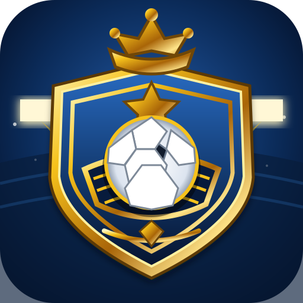

# ⚽ Football Dynasty 2.0

<p align="center">
  
</p>

<p align="center">
  <strong>Build your club. Shape your career. Create your legacy.</strong><br/>
  An independent football management and player-career game.
</p>

<p align="center">
  <a href="https://github.com/BiigMT/Football-dynasty-2.0/releases">Android beta releases</a> ·
  <a href="https://github.com/BiigMT/Football-dynasty-2.0/issues">Report a bug</a>
</p>

## About

Football Dynasty is an independent football game project focused on club management, squad building, transfers, matchday presentation and a player-career journey.

The project is in **public beta**. Features, balance, performance and compatibility may change as development continues.

## Features

- Manager career and club development
- Player career progression
- Squad management and competition
- Transfer and contract workflows
- Matchday and football presentation
- Android experience powered by Capacitor

Feature availability may vary between beta builds.

## Download the Android beta

1. Open the [GitHub Releases page](https://github.com/BiigMT/Football-dynasty-2.0/releases).
2. Choose the release marked **Pre-release**.
3. Download the APK asset attached to that release. Do not download the source-code ZIP if you want to install the game.
4. On Android, allow installation from your browser or file manager if prompted, then open the downloaded APK.

**Beta warning:** This is test software. Back up your progress where possible. A future release signed with a different key may not install as an update over an earlier test build.

## Report bugs and share feedback

Please [open an issue](https://github.com/BiigMT/Football-dynasty-2.0/issues) and include:
- Your device model and Android version
- The game version/build
- What you expected to happen
- What actually happened
- Steps to reproduce the problem
- Screenshots or a screen recording, if useful

Do not post passwords, private keys, signing files or personal payment information in issues.

## Support development ❤️

Football Dynasty is independently developed. Contributions help fund development time, testing, art, licensed assets and future improvements.

**International donations are being arranged.** A verified payment link will be added here once the creator's payout and withdrawal method is confirmed. Please do not send money to unofficial accounts claiming to represent Football Dynasty.

## Community

- GitHub: [BiigMT / Football-dynasty-2.0](https://github.com/BiigMT/Football-dynasty-2.0)
- Bug reports: [GitHub Issues](https://github.com/BiigMT/Football-dynasty-2.0/issues)

## Development

The project uses React, TypeScript, Vite, Tailwind CSS and Capacitor.

Typical local commands:

```bash
npm install
npm run lint
npm run build
npx cap sync android
```

## Credits and licensing

Football Dynasty is an independent project. Third-party names, logos, photographs, libraries and other assets remain the property of their respective owners and are used only under their applicable licenses or terms. Do not assume that any third-party club, league or player branding is officially affiliated with this project.

---

Made with passion for football. ⚽
